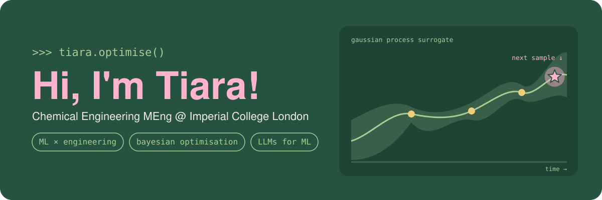

## About me
I'm a third-year chemical engineering student at Imperial College London, researching applications of machine learning to chemical engineering and bioprocessing.

## Observations so far
- Machine learning for engineering problems
- Bayesian optimisation
- LLMs for machine learning and optimisation ← *next sample*

## Hyperparameters
| parameter | value |
|---|---|
| `languages` | Python, MATLAB |
| `machine_learning` | PyTorch, scikit-learn, GPyTorch, BoTorch |
| `scientific_computing` | NumPy, Pandas, SciPy, Matplotlib |
| `tools` | Git, Jupyter |

## Education
- MEng in Chemical Engineering @ Imperial College London (2024–2028)

## Query me

